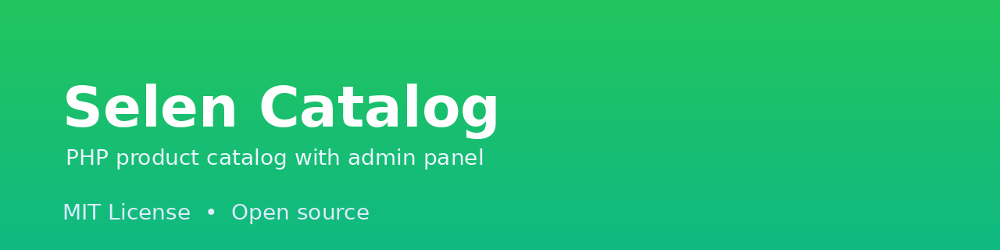
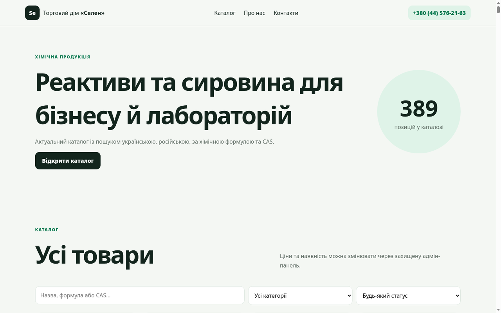

# Selen Product Catalog

A PHP-based product catalog for chemical reagents and related products. It includes a public catalog, product pages, search and an admin panel for editing products, packaging, prices and catalog content.



## Features

- Public product catalog.
- Product detail pages.
- Search by name, formula and CAS number.
- Admin panel for adding, editing, duplicating and deleting products.
- Packaging and price management.
- Google Maps location block.
- Contact information.

## Requirements

- PHP 8.0 or newer.
- Write access to the `data/` directory.

## Quick start

```bash
php -S 127.0.0.1:8000
```

Open `http://127.0.0.1:8000`.

## Admin panel

The admin panel is available at `/admin/`.

- Change the default administrator password immediately after first login.
- Do not publish `data/admin.json` with a real password hash.
- Keep the `data/` directory writable by the web server.

## Project structure

```text
selen/
├── index.php
├── product.php
├── admin/
├── data/
├── lib.php
├── script.js
└── styles.css
```

## License

This project is licensed under the [MIT License](LICENSE).

## Українською (коротко)

Selen — PHP-каталог товарів хімічних реактивів із публічними сторінками товарів, пошуком і адмін-панеллю. Потрібен PHP 8.0+, запис у папку `data/`. Запуск: `php -S 127.0.0.1:8000`. Обов'язково змініть пароль адміністратора після першого входу.